<!--
  Generated by scripts/build.py; edit that, not this file.
  Bento grid: each tile is an SVG in /assets. Keep every row on one line with no
  spaces between tags: the gaps live inside the SVGs.
-->

<a href="https://github.com/shira421/seekcamera-glass-detection"></a> 
<a href="https://github.com/shira421/cg3207_labs"></a><a href="https://github.com/AY2526S1-CS2113-W13-1/tp"></a><a href="https://github.com/shira421/ee2026_b02_g10"></a> 
<a href="https://github.com/shira421/uwash-dashboard"></a><a href="https://github.com/lukeai-tan/claude-hackathon"></a> 
 
 
 
 
 

Read as plain text

### Ksheerabthi Nathan (Canary)
Year 3 Computer Engineering at the National University of Singapore. I work on embedded software, FPGA design and real-time computer vision.

**Experience**
- **PROX SG**, Embedded Software Engineer Intern (Dec 2025 – Jan 2026). Built a real-time thermal imaging system that detects and ranges clear glass for robots, with a C++ vision pipeline on embedded Linux. [Repo](https://github.com/shira421/seekcamera-glass-detection)

**Projects**
- **RISC-V CPU** (CG3207, now). RISC-V processor in Verilog on a Nexys 4 FPGA, with a multi-cycle radix-4 Booth multiply/divide unit. [Repo](https://github.com/shira421/cg3207_labs)
- **ZettelCLI** (CS2113). Java CLI for Zettelkasten notes; Gradle, JUnit, Checkstyle and CI on GitHub Actions. [Repo](https://github.com/AY2526S1-CS2113-W13-1/tp)
- **FPGA Calculator** (EE2026). Arithmetic and graphing calculator on a Basys3 driving dual 96×64 OLEDs over custom SPI. [Repo](https://github.com/shira421/ee2026_b02_g10)
- **UWash** (NUS Student Life Hack, Top 8). ESP32 vibration sensor and web dashboard for NUS laundry rooms. [Repo](https://github.com/shira421/uwash-dashboard)
- **OpenSuite** (Claude hackathon, team). Free, local-first desktop app replacing paid PDF and slide tools: in-place PDF editing, redaction and OCR, a slide canvas that exports editable `.pptx`, and an AI design helper on the Claude API. [Repo](https://github.com/lukeai-tan/claude-hackathon)
- **DSTA BrainHack 2024** (Finalist). Sustainability-focused mobile app built in 48 hours with React Native, Django and AWS.

**Education**: B.Eng (Hons) Computer Engineering, NUS, 2024 – 2028. GPA 4.31/5.0. Embedded and Large-Scale Computing, minor in Quantitative Finance. TA for EG1311.

**Highlights**: Represented Singapore at RoboCup Worldwide 2021 · Best Engineering & Distinction, RoboCup Singapore Open 2021 · Champions, YDSP Data Analytics 2018.

**Contact**: [LinkedIn](https://www.linkedin.com/in/ksheerabthi/) · [k.nathan@u.nus.edu](mailto:k.nathan@u.nus.edu)

