<!-- Generated by scripts/build.py; edit that, not this file. -->

<h2 align="center">Hi, I'm Ksheerabthi</h2>

Currently dabbling with FPGAs.

### Past Projects

 
 

### Tech stack
**Languages** 
     

**Tools & platforms** 
      

**Hardware** 
   

### GitHub stats

### Contact
 
